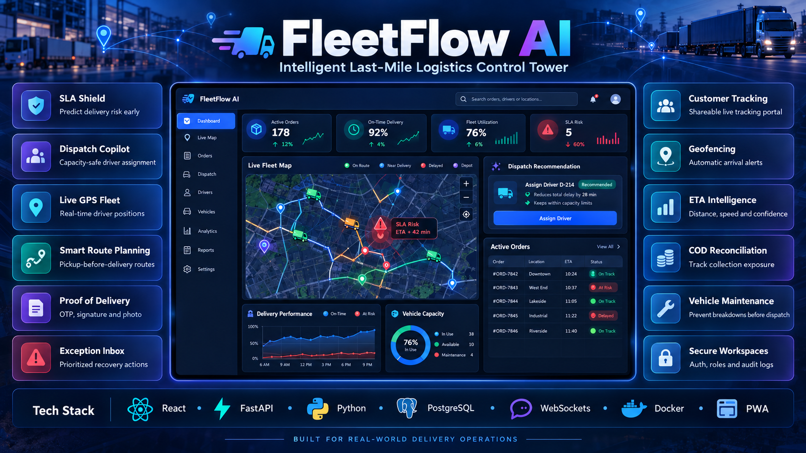

# FleetFlow AI



FleetFlow is a logistics control tower for small and mid-sized delivery teams. It turns order, driver, location and route data into dispatch decisions that an operations manager can review and approve.

## Product vision

The product is built around a simple idea: dispatchers should see the next operational risk before it becomes a missed delivery. FleetFlow combines verified locations, capacity-aware assignment, route sequencing and explainable decision support in one workspace.

## What is implemented

- React + Vite operations dashboard with Dashboard, Orders, Drivers, Routes and Analytics workspaces.
- FastAPI + SQLAlchemy backend backed by PostgreSQL.
- Order and driver management with assignment and delivery lifecycle updates.
- Address verification with OpenStreetMap Nominatim and saved coordinates.
- Pickup-before-delivery route optimization and optional OSRM road distance estimates.
- Capacity-aware Dispatch Copilot that scores drivers by proximity, remaining capacity and workload, then requires manager approval before assignment.
- SLA Shield explainable intelligence brief with live risk scoring, fleet utilization, priority exceptions and suggested next actions.
- Searchable and filterable order operations plus driver capacity heatmap.
- JWT authentication with an owner workspace account and protected operations API.
- Live driver GPS ingestion endpoint, latest-position feed and authenticated WebSocket stream.
- In-app operational notifications with unread state and browser-ready polling.
- Expiring customer tracking links with a public, privacy-safe delivery portal and timeline.
- Automated backend tests for security, route constraints and SLA risk scoring.
- Docker Compose deployment with PostgreSQL, FastAPI and Nginx-served React frontend.
- Industry workflows: proof of delivery, geofence arrival alerts, ETA recalculation, failed-delivery recovery, COD reconciliation and preventive maintenance.
- Exception inbox, dispatch what-if simulation, integration import idempotency, audit log and installable PWA shell.

## Portfolio honesty / feature status

The core operations product is implemented in this repository: authentication, dispatch workflows, route sequencing, SLA Shield, Dispatch Copilot, GPS ingestion/WebSocket streaming, customer tracking, proof of delivery, geofencing, ETA calculation, COD records, maintenance records, exception management and audit logging.

The notification and integration layers are provider-ready. SMS, WhatsApp, email, Shopify and WooCommerce require production credentials and webhook configuration before they can send or ingest live third-party traffic. The showcase image is a product overview graphic; dashboard numbers shown inside it are illustrative and should not be presented as live production metrics.

For a recruiter demo, describe FleetFlow as an explainable last-mile logistics control tower and call out the exact workflow you can demonstrate live: create an order, verify its locations, assess a driver with Dispatch Copilot, generate a customer tracking link, send a GPS point, trigger a geofence event and close the delivery with proof.

## Run locally

1. Create a PostgreSQL database named `fleetflow_db` and copy `Backend/.env.example` to `Backend/.env`.
2. Install backend dependencies and initialize tables:

   ```powershell
   cd Backend
   python -m pip install -r requirements.txt
   python init_db.py
   python seed_demo.py
   uvicorn app.main:app --reload
   ```

3. Start the frontend in a second terminal:

   ```powershell
   cd frontend
   npm install
   npm run dev
   ```

The frontend expects FastAPI at `http://127.0.0.1:8000`.

## Production-style launch with Docker

From the repository root:

```powershell
docker compose up --build
```

Open `http://localhost:5173`, create the first owner account, then use the Orders workspace to generate a customer tracking link. Before a public launch, replace `JWT_SECRET_KEY`, database credentials and the development CORS origins with managed secrets and your production domain.

## Automated tests

```powershell
cd Backend
python -m unittest discover -s tests -v
```

## Real-time driver integration

Driver apps or a hardware gateway can send authenticated GPS points to `POST /drivers/{driver_id}/location`. Operations clients subscribe to `/ws/fleet?token=<access_token>` and receive location events immediately. The database also retains the location history for audit and replay.

## Product positioning

FleetFlow is intentionally transparent about its intelligence layer. SLA Shield is deterministic, evidence-backed decision support rather than an opaque autonomous dispatcher. That makes each recommendation explainable to a manager and safe to demonstrate in a real operations workflow.

## Publish to GitHub

Create an empty public repository named `fleetflow-ai` on GitHub, then run these commands from the project root:

```powershell
git init
git branch -M main
git add .
git status --short
git commit -m "feat: launch FleetFlow AI logistics control tower"
git remote add origin https://github.com/<your-username>/fleetflow-ai.git
git push -u origin main
```

Before committing, confirm that `Backend/.env`, `Backend/venv`, `frontend/node_modules` and `frontend/dist` do not appear in the staged files. Only `.env.example` files should be published. The repository includes a GitHub Actions workflow at `.github/workflows/ci.yml` that runs backend tests, Python compilation, frontend linting and the production build on every push and pull request.
