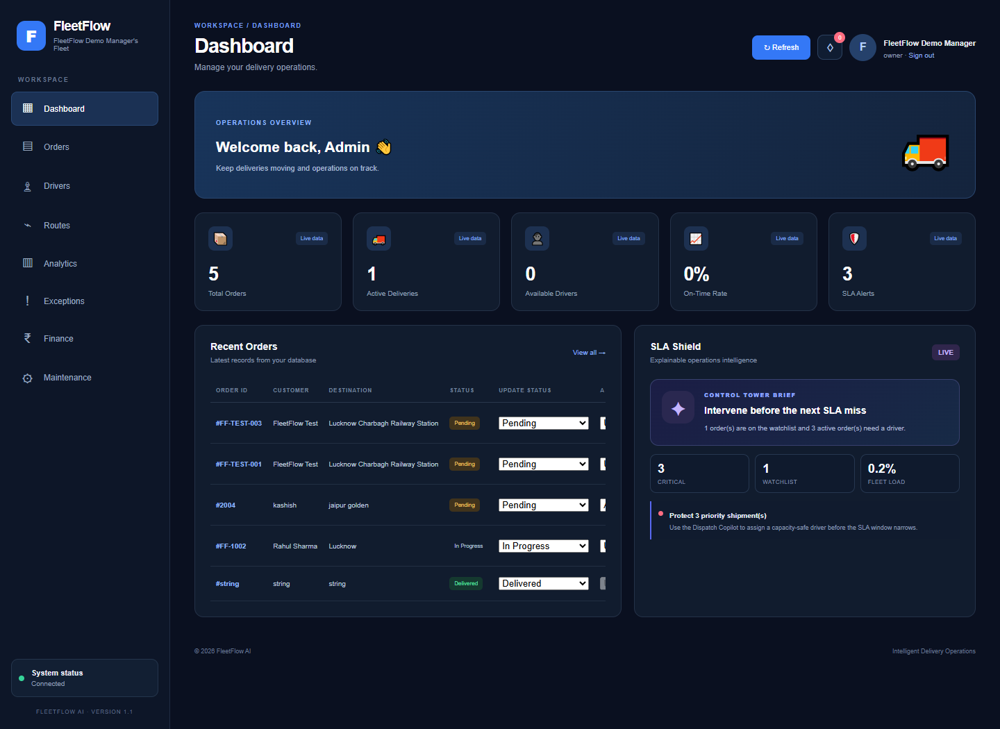
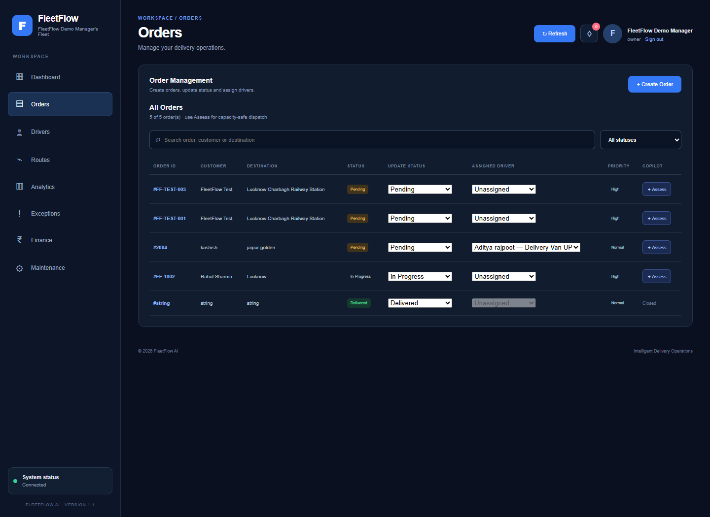
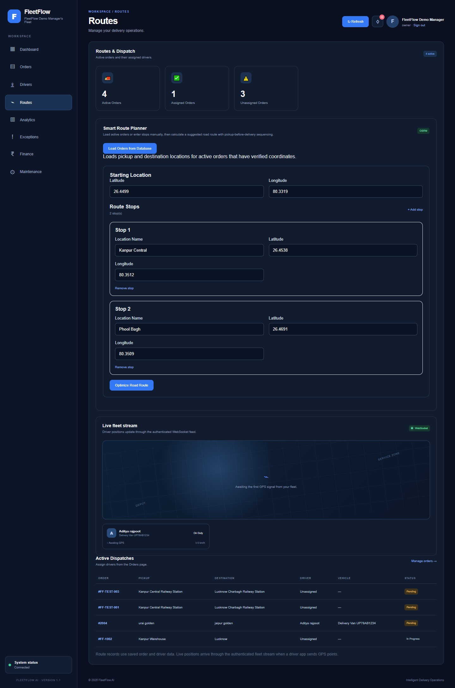
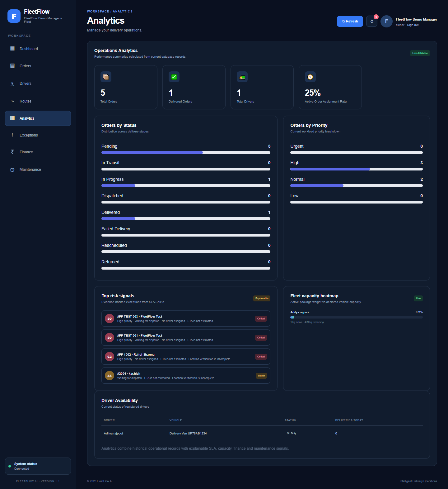

# 🚚 FleetFlow AI

<h3 align="center">
AI-Powered Last-Mile Logistics Control Tower
</h3>

<p align="center">
Turn orders, driver capacity, GPS signals and delivery events into explainable dispatch decisions.
</p>

---

## 🚀 Overview

FleetFlow AI is a real-world logistics operations platform for small and mid-sized delivery teams. It helps dispatch managers monitor fleet health, identify SLA risk, assign the right driver, share safe customer tracking links and close deliveries with verifiable proof.

The project is designed around a practical operations workflow: every recommendation is reviewable, every important event is auditable and provider integrations can be enabled when production credentials are available.

## ✨ Features

- 📊 Operations dashboard for orders, drivers, routes and analytics
- 🛡️ SLA Shield with explainable risk scores and suggested next actions
- 🤖 Dispatch Copilot for capacity-aware driver recommendations with manager approval
- 🗺️ Address verification, pickup-before-delivery route sequencing and ETA calculation
- 📍 Authenticated GPS ingestion with latest-position feed and real-time WebSocket updates
- 🔐 Owner authentication and protected operations APIs
- 🔔 In-app notifications, exception inbox and audit log
- 📦 Delivery lifecycle management: failed, rescheduled, returned and delivered orders
- 🔗 Expiring customer tracking links with a privacy-safe public portal
- ✅ Proof of delivery with recipient, signature, OTP verification and notes
- 🧭 Geofence arrival alerts and driver location history
- 💰 COD reconciliation, preventive maintenance and dispatch what-if simulation
- 📥 Idempotent integration import workflow for external order feeds
- 📱 Installable PWA shell for operations teams
- 🐳 Docker Compose deployment with PostgreSQL, FastAPI and Nginx
- 🧪 Automated backend tests plus frontend lint and production build checks

## 🛠 Tech Stack

| Frontend | Backend | Data & Delivery |
|---|---|---|
| React 19 | FastAPI | PostgreSQL |
| Vite | Python | SQLAlchemy |
| CSS | WebSockets | Docker Compose |
| Axios | Uvicorn | Nginx |

## 📂 Project Structure

```text
FleetFlow AI/
├── Backend/
│   ├── app/
│   ├── tests/
│   ├── init_db.py
│   └── seed_demo.py
├── frontend/
│   ├── src/
│   └── public/
├── .github/workflows/ci.yml
├── docker-compose.yml
├── screenshots/
│   ├── dashboard.png
│   ├── orders.png
│   ├── routes-dispatch.png
│   └── analytics.png
├── LICENSE
└── README.md
```

## 📸 Screenshots

### Operations Dashboard



### Order Management



### Routes & Dispatch



### Analytics



## ⚙️ Installation

### Clone the repository

```bash
git clone https://github.com/kashishawasthiii/fleetflow-ai.git
cd fleetflow-ai
```

### Backend

```powershell
cd Backend
python -m venv venv
venv\Scripts\activate
python -m pip install -r requirements.txt
Copy-Item .env.example .env
python init_db.py
python seed_demo.py
uvicorn app.main:app --reload
```

### Frontend

Open a second terminal:

```powershell
cd frontend
npm install
npm run dev
```

Open `http://localhost:5173` in your browser. The frontend expects FastAPI at `http://127.0.0.1:8000`.

### Docker launch

From the repository root:

```powershell
docker compose up --build
```

Before a public launch, replace the development database credentials, `JWT_SECRET_KEY`, CORS origins and third-party provider settings with managed production secrets.

## 🧠 How It Works

1. A manager creates or imports an order and verifies pickup and destination coordinates.
2. SLA Shield scores delivery risk from priority, due time, assignment and operational signals.
3. Dispatch Copilot ranks eligible drivers using capacity, proximity and workload.
4. A manager approves the assignment and the driver sends authenticated GPS updates.
5. The team monitors live events, geofence alerts and exceptions in the control tower.
6. The customer receives an expiring tracking link, and the team closes the order with proof of delivery.

## 🧪 Automated Tests

```powershell
cd Backend
python -m unittest discover -s tests -v
```

The GitHub Actions workflow also runs Python compilation, backend tests, frontend linting and the production build for every push and pull request.

## 📌 Feature Status

The core operations workflows are implemented and demo-ready in this repository. SMS, WhatsApp, email, Shopify and WooCommerce connectors are provider-ready; live traffic from those services requires production credentials and webhook configuration.

The showcase images are visual product assets. Any dashboard numbers shown in them are illustrative, not live production metrics.

## 🤝 Contributing

1. Fork the repository.
2. Create a feature branch: `git checkout -b feature-name`
3. Make and test your changes.
4. Commit and push your branch.
5. Open a pull request.

## 📄 License

This project is licensed under the [MIT License](./LICENSE).

## 👨‍💻 Author

**Kashish Awasthi**  
Computer Science Engineering Student  
AI • Machine Learning • Full Stack Development

---

<p align="center">
Built with React, FastAPI and a focus on safer, more explainable logistics operations.
</p>
